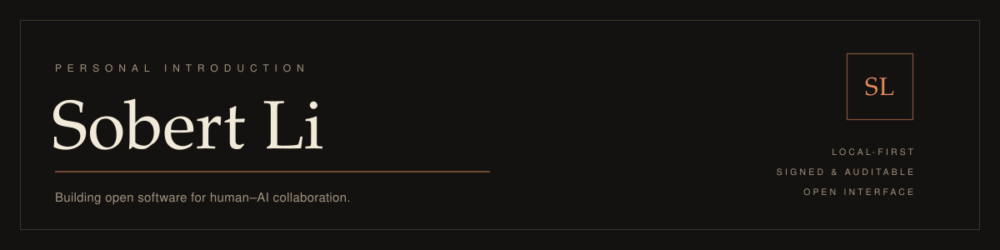

<picture>
  <source media="(prefers-color-scheme: light)" srcset="assets/banner-light.svg">
  
</picture>

English · <a href="README.zh-CN.md">中文</a>

---

I'm Sobert Li. I build tools that help people and AI agents work together — without giving up ownership of their data.

Most of my time goes into **[Mebular](https://github.com/Windsander/Mebular)**, a distributed memory and task network for AI assistants.

## Now

### Mebular

> One memory. Every assistant. Every device.

Memory and tasks stay on your devices and sync directly between them. Changes are signed and can be audited afterwards, and everything is exposed to assistants over MCP.

- **Local-first** — no hosted account, no central coordinator
- **Signed and auditable** — a history you can actually verify
- **Direct device-to-device sync** — your devices, talking to each other
- **Open interface** — memory and tasks over MCP, for the assistants you already use

`TypeScript` · `Node.js` · `Electron` · `MCP`

→ [Repository](https://github.com/Windsander/Mebular) · [Website](https://mebular.cyberfederal.io) · [Quickstart](https://github.com/Windsander/Mebular/blob/main/docs/getting-started/QUICKSTART.md)

## Work

| Project | What it is |
| --- | --- |
| **[Mebular](https://github.com/Windsander/Mebular)** | A distributed memory and task network for AI assistants — local-first, signed, directly synced, no hosted account. |
| **[CodeKeeper](https://github.com/Windsander/CodeKeeper)** | A local-first desktop workbench for multi-project AI agent collaboration: code review, maintenance fixes, and knowledge archiving backed by long-term memory. |
| **[ADI-Stable-Diffusion](https://github.com/Windsander/ADI-Stable-Diffusion)** | A universal C/C++ inference framework for Stable Diffusion, built on ONNX Runtime and running across platforms. |
| **[Guideof-MultimediaArchitect](https://github.com/Windsander/Guideof-MultimediaArchitect)** | *Audio-Visual Development Technology: Principles and Practices* — a long-form guide to the craft. |
| **[ScriptToolBox](https://github.com/Windsander/ScriptToolBox)** | Small scripts and utilities worth keeping around. |

## Principles

- **Local-first by default.** Tools should keep working when the cloud doesn't.
- **Show the edge.** Every sync, signature, and change should be inspectable, not taken on faith.
- **Your memory is yours.** What an assistant learns about you shouldn't require an account on someone else's server.

## Contact

- GitHub — [Sobert Li](https://github.com/Windsander)
- Mebular — [mebular.cyberfederal.io](https://mebular.cyberfederal.io)
- Questions, ideas, use cases — open an issue or a discussion in the relevant repository.
